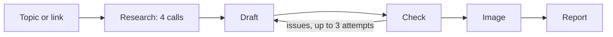

# Vidya Content Agent

A Next.js 15 app that turns a topic or a news link into ready-to-review marketing posts and ads for a fictional client, Vidya AI. Vidya AI is an AI tutor for Class 6-12 CBSE/ICSE students. Its buyers are parents. Built by Team Alpha for the BFWAI FDE Fellowship (Task 2).

**You enter:** a topic or a link, optional notes, and the content types you want (blog, LinkedIn, X thread, Instagram, Meta ads, Google ads, image).

**You get back:** a reviewed content pack. It has the facts the agent found, one piece per type you ticked, an image brief with a generated image, and a short report. A human reviews everything. Nothing is published or sent.

## Setup

Node 20 or newer is a safe choice. `package.json` does not pin a version, but Next 15 and Vitest 5 need a current Node.

```bash
npm install
cp .env.example .env.local
```

Open `.env.local` and set `OPENROUTER_API_KEY`. Models are optional and default as below.

| Variable | Default | Used for |
| --- | --- | --- |
| `OPENROUTER_API_KEY` | none (required for live runs) | All calls, through OpenRouter |
| `TEXT_MODEL` | `google/gemini-2.5-flash` | Research merge, draft, check and report |
| `SEARCH_MODEL` | `google/gemini-2.5-flash:online` | Web-search research for topic input |
| `IMAGE_MODEL` | `google/gemini-2.5-flash-image` | Image generation |

## Run

```bash
npm run dev
```

Open http://localhost:3000. To try the UI with no key, open http://localhost:3000/?demo. It runs on canned data.

The screen first shows progress as each stage runs, then cards for the research and each piece. A piece the checker still rejects after 3 attempts is held. You can revise a held piece with a note, or use it anyway.

## Test

```bash
npm test
```

This runs Vitest (`vitest run`). It needs no key.

## Eval script

Runs one full pack (all 7 types) against the real stages and needs `OPENROUTER_API_KEY` in `.env.local`.

```bash
# topic
npm run eval -- "Helping your child prepare for board exams without stress"

# link (any argument starting with http is treated as a link)
npm run eval -- "https://www.educationtimes.com/learning/cbse-board-exam-2027-class-10-12-how-parents-can-help-their-kids-without-panic/articleshow/134004454.cms"
```

It prints each progress event with elapsed seconds, then a table of type, status and attempts, the pass rate, and counts of facts and angles with total time. In link mode it also counts the `topic-*` facts sourced from the link. After that it lists research errors and conflicts, the first piece that did not pass (with the checker's blocking issues), and the report summary. The full result is written to `eval-output/<timestamp>.json`. That folder is gitignored.

## How it works



Each stage is a separate API call, and its output is nested into the next stage's prompt. Each piece loops between draft and check for at most 3 attempts. Length and format limits are checked in code, because the LLM checker cannot count characters reliably. See [docs/ARCHITECTURE.md](docs/ARCHITECTURE.md) for the call chain, prompt nesting and file table.

## Demo notes

These come from live eval runs on 2026-10-27 (`google/gemini-2.5-flash` via OpenRouter).

**One evaluation result.** Topic run, "Helping your child prepare for board exams without stress": 7/7 pieces passed (100%). 26 facts, 4 angles, 0 research errors, 0 conflicts. Research took 18.9s and the whole pack 33.1s.

| Type | Attempts |
| --- | --- |
| blog | 1 |
| linkedin | 1 |
| x_thread | 1 |
| instagram | 1 |
| meta_ads | 1 |
| google_ads | 3 |
| image | 1 |

The link run also passed 7/7 in 25.9s with 23 facts and 3 angles. 8 of the facts were sourced from the linked article.

**One failure.** In the topic run, google_ads attempt 1 was blocked by the code check with three length violations:

- "Google ad variation 1, description 1 is 98 characters; the limit is 90."
- "Google ad variation 2, description 1 is 105 characters; the limit is 90."
- "Google ad variation 3, description 1 is 97 characters; the limit is 90."

Attempt 2 still had two of them (97 and 92 characters). Attempt 3 passed. The LLM checker's own reasoning on attempt 1 said all limits were met, which is why these rules are code. The checker's reasoning now opens with the automatic check results, so a held card no longer contradicts its blocking issues. A separate first topic run failed entirely: every piece errored with "[Google AI Studio] google/gemini-2.5-flash is temporarily rate-limited upstream". Research kept its 27 facts and recorded the failed merge as an error.

**One limitation.** All 7 pieces start in parallel, so one upstream rate limit can error the whole pack. There is no backoff beyond one retry. The checker also adds many trivial minor notes, which are shown but do not block a pass.

## Project layout

```
src/app/          page.tsx (the UI) and api/ routes: research, draft, check, image, report
src/components/   input form, progress view, result cards, hold review
src/lib/          orchestrator, stages/, agents/, prompts, channel rules, demo data
scripts/eval.ts   live eval script
docs/             ARCHITECTURE.md, design spec and plan under superpowers/
```

The full file table is in [docs/ARCHITECTURE.md](docs/ARCHITECTURE.md).
