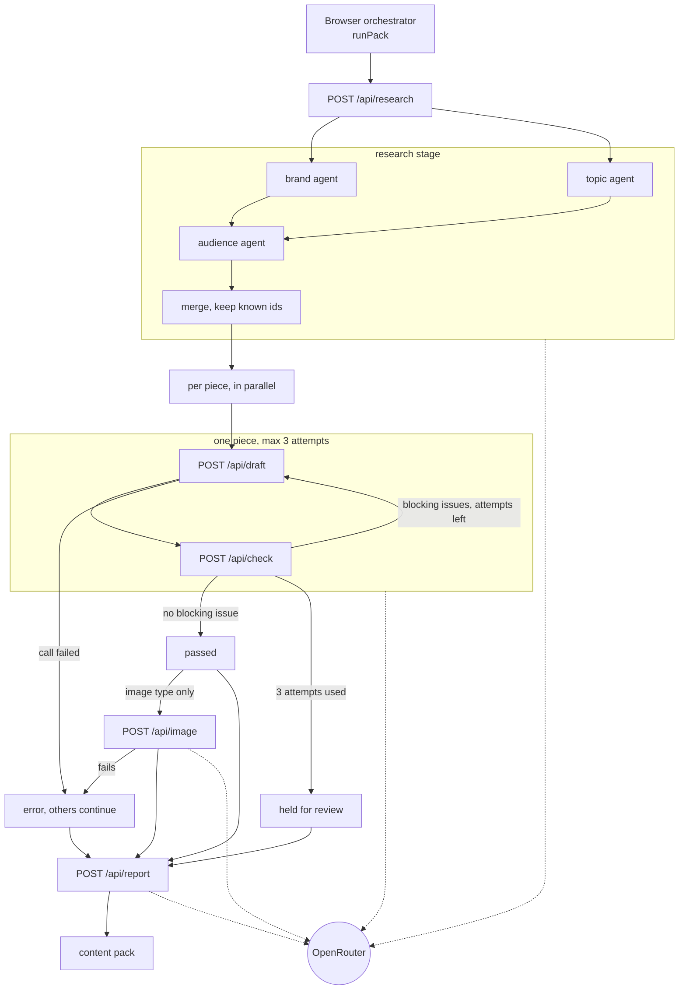
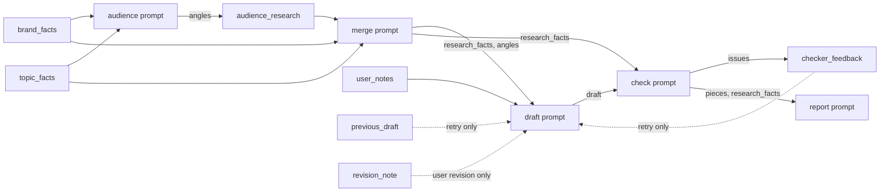

# Architecture

## Overview

The app is a Next.js 15 (App Router, TypeScript) tool that turns a topic or a link into marketing posts and ads for a fictional client, Vidya AI, an AI tutor whose buyers are parents of CBSE/ICSE students. A marketer enters a topic and/or a link, optional notes, and picks content types (blog, LinkedIn, X thread, Instagram, Meta ads, Google ads, image). The output is a reviewed content pack: the research facts used, one piece per type (each passed, or held for review), a generated image if requested, and a short client-facing report. Nothing is published, and there is no database or login.

The work is a chain of separate AI calls, not one big prompt. Each call has one job, a Zod-validated output, and its own timeout. That lets us ground each step (research before writing), review each step (a separate checker judges every draft), retry only what failed, and show the marketer what happened at each stage. The orchestrator runs in the browser and calls five server routes. Pieces run in parallel, so one slow or failed piece does not block the rest.

## Diagram 1: the call chain



Notes on the diagram:
- Research runs brand and topic together, then audience (which sees both), then the merger. The brand agent reads the live Vidya site. The topic agent reads the link, or does a web search with the `:online` model when only a topic is given.
- The browser calls draft and check one after the other for each piece. Each retry sends the best earlier draft and all issues raised so far.
- Image generation starts only after its brief passes. A held brief gets no image until the user revises it or uses it anyway.
- The report runs once at the end, over all pieces and the research notes.

## Diagram 2: prompt nesting

Earlier outputs never enter a prompt as loose text. `nest(tag, value)` in `src/lib/prompts.ts` wraps them as `<tag>...</tag>` (JSON for objects, `(none)` when empty), and the instructions refer to the tags by name.



A draft prompt on a retry looks like this (abridged):

```text
<research_facts>[ {"id":"brand-1","fact":"Vidya AI costs ₹499/month.", ...} ]</research_facts>
<angles>[ ... ]</angles>
<user_notes>Topic and notes from the form</user_notes>
<previous_draft>{ best attempt so far }</previous_draft>
<checker_feedback>[ every issue from every earlier attempt, deduplicated ]</checker_feedback>
Instructions: edit <previous_draft>, fix every blocking issue, use only facts from <research_facts>.
```

## Grounding and safety

- **Fact ids are assigned in code.** Brand facts are a hand-written baseline (`brand-N`). The live-site agent adds `site-N` facts and the topic agent adds `topic-N`. The code numbers them, never the model.
- **The merger returns only ids.** It cannot reword or invent a fact: kept facts are the originals, looked up by id, and unknown ids are discarded. Angles are also filtered to known ids, and an angle with no supporting fact is dropped. If the merger keeps no known fact, it throws and research falls back (see Failure handling).
- **Topic sources are traced.** In topic-only mode a fact is kept only if its source URL matches a URL the search returned. In link mode the source URL is always the link.
- **The checker has two parts.** An LLM review (grounding in the facts, brand rules, tone, audience, format), plus deterministic rules in `src/lib/channel-rules.ts`: X posts at most 280 characters, Google headlines at most 30 and descriptions at most 90, a blog needs a title and at least two sections, Instagram needs a hashtag, Meta ads need all fields, and no fact id (`brand-3`, `site-1`, `topic-2`) may appear in the copy. Rule violations are always blocking.
- **Blocking vs minor.** A piece passes when it has no blocking issue. The LLM's own pass flag is ignored. Minor issues are recorded and shown, and they do not stop a pass.
- **Hold for review.** If none of the 3 attempts passes, the piece is held on its best attempt (fewest blocking issues, then fewest total, then latest). The card explains why, including rules that blocked every attempt. The user can revise with a note (one more draft and check round that includes the note) or use the draft anyway. Using it marks it accepted by the user and, for an image brief, then generates the image. A human always decides.

## Failure handling

- **Research degrades instead of failing.** Each sub-step is caught and recorded in `research.errors`, and the run continues. No brand result falls back to the baseline facts. No topic result means no topic facts. Audience failure means no angles. Merge failure returns the unmerged brand and topic facts. Thin pages (under 200 characters of text, often JavaScript-rendered) and empty extractions count as errors. The errors appear in the UI and in the report.
- **Timeouts and retries.** Each route has `maxDuration = 60`. Research calls get 20 s each, draft, check and report get 40 s, and the image request gets 50 s. The AI SDK retries a failed API call once (`maxRetries: 1`). If a reply does not match its schema, `withSchemaRetry` runs the draft or check once more inside the same 40 s deadline, and skips the retry if less than 5 s is left.
- **Errors stay local.** `stageRoute` validates the request with Zod (a 400 names the field) and returns the message with a 500 on failure. In the browser, a draft or check failure affects only that piece: with an earlier attempt, the piece is settled from it (passed or held) with an error note, and otherwise it becomes an `error` piece. An image failure marks the piece as an error but keeps its draft. A report failure becomes a "Report unavailable" summary. The other pieces always finish.

## Where things live

| Path | Responsibility |
| --- | --- |
| `src/app/page.tsx` | Page state, picks the real or demo API, wires revise and accept |
| `src/components/` | Form, progress view, piece cards, hold review, research panel (agent details sit behind small Details toggles) |
| `src/app/api/*/route.ts` | The five routes: research, draft, check, image, report |
| `src/lib/route-helper.ts` | `stageRoute`: JSON parse, Zod validation, error responses |
| `src/lib/orchestrator.ts` | `runPack`, the draft and check loop, `revisePiece`, `acceptPiece` (runs in the browser) |
| `src/lib/stage-api.ts` | `StageApi` interface and `httpApi` (fetch to the routes) |
| `src/lib/review.ts` | Best-attempt choice, feedback gathering, hold analysis |
| `src/lib/stages/` | Server stage logic: research, draft, check, image, report, `schema-retry` |
| `src/lib/agents/research-agents.ts` | The four research calls: brand, topic, audience, merge |
| `src/lib/prompts.ts` | All prompt builders and `nest()` |
| `src/lib/channel-rules.ts` | Deterministic per-channel checks |
| `src/lib/brand-facts.ts` | Trusted Vidya fact baseline and site URL |
| `src/lib/models.ts` | Model ids, API key access, time budgets (server-only) |
| `src/lib/fetch-page.ts` | Server-side page fetch and text extraction (capped at 20,000 characters) |
| `src/lib/types.ts` | Zod schemas and types for requests, drafts, checks, results |
| `src/lib/demo-api.ts` | Canned offline `StageApi`, opened with `/?demo` |
| `src/lib/direct-api.ts` | A server-only `StageApi` that calls the stage functions directly |

## Configuration

Set in `.env.local` (see `.env.example`):

| Variable | Purpose | Default |
| --- | --- | --- |
| `OPENROUTER_API_KEY` | Required for real runs | none |
| `TEXT_MODEL` | Research, merge, draft, check, report | `google/gemini-2.5-flash` |
| `SEARCH_MODEL` | Topic-only web search | `google/gemini-2.5-flash:online` |
| `IMAGE_MODEL` | Image generation | `google/gemini-2.5-flash-image` |

The key is read only in server code: `src/lib/models.ts` and the image stage, which imports it. `models.ts` imports `server-only`, so a client bundle that pulled it in would fail to build. The browser only calls `/api/*` with stage data. `/?demo` needs no key.

## Where the code differs from the spec

- The spec describes one `/api/generate` route. The code has five stage routes, and the browser runs the loop.
- The spec says the live site wins when it disagrees with the baseline. The code keeps all baseline facts, adds the page's version as a new `site-N` fact, and passes the conflicts to the report. It never removes or replaces a baseline fact.
